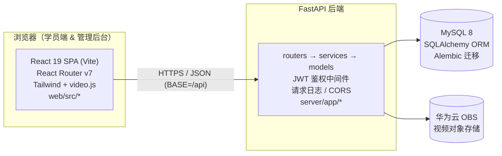

# Hi-Tronics 在线学习平台 · 代码架构导航图

> 路径基准（项目根）：`Hi-Tronics-Learning-platform/`
> 生成于 2026-09-04 · 用途：让 Claude / 开发者按功能一键定位源码文件
> 所有下方路径均为相对项目根的路径。

## 技术栈

- **前端**：React 19 + Vite + TypeScript + Tailwind CSS v4 + React Router v7 + video.js
- **后端**：FastAPI + uvicorn（Python），分层结构 `routers → services → models → schemas`
- **数据库**：MySQL 8，SQLAlchemy 2 ORM，Alembic 迁移
- **对象存储**：华为云 OBS（视频），本地回退 `server/uploads/videos/`
- **认证**：JWT（HS256），有效期 24h，token 存 localStorage（`web/src/lib/api.ts` 注明存在 XSS 风险）；企业微信 OAuth 配置已预留

---

## 1. 系统架构总览

**认证说明**：JWT 存于 localStorage（XSS 风险，见 `web/src/lib/api.ts` 注释）；有效期 24h；企业微信 OAuth 字段（`WECHAT_CORP_ID` 等）已在 `server/app/config.py` 预留。

---

## 2. 后端分层结构（`server/app/`）

| 文件 / 目录 | 作用 |
|---|---|
| `main.py` | 应用入口：注册 14 个 router、CORS、请求日志中间件；lifespan 中建表 + 种子内置管理员 |
| `config.py` | `Settings`：DB / JWT / OBS / 企业微信 配置，全部来自环境变量 |
| `database.py` | SQLAlchemy engine、`SessionLocal`、`Base` |
| `logger.py` | 结构化日志 `setup_logging` / `get_logger` |
| `routers/` | 14 个路由模块（见 §3 功能映射） |
| `services/` | `auth_service.py`（登录/密码校验）、`seed.py`（内置管理员） |
| `schemas/` | Pydantic 校验：auth / user / exam / course / question / paper / question_tag / department |
| `models/` | ORM 模型：user / department / course / exam / question / paper / question_tag / question_category / learning_progress |
| `tests/` | `test_auth.py`、`test_exam_flow.py`（pytest） |
| `alembic.ini` | 数据库迁移配置 |

**router 注册清单（在 `main.py`）**：auth, users, departments, courses, videos, questions, exams, student_exam, question_tags, question_categories, learning_progress（含 admin_router）, papers, logs。

---

## 3. 功能 → 代码定位映射（核心）

> 每张表给出：前端路由 + 页面组件、后端 router + 关键端点、涉及模型/校验层。
> 路径均相对项目根。

### 3.1 登录 / 认证
- **路由**：`/login`
- **前端**：`web/src/pages/Login.tsx` · `web/src/hooks/useAuth.tsx` · `web/src/lib/api.ts`（`login` / `getMe`）
- **后端**：`server/app/routers/auth.py`
- **端点**：`POST /api/auth/login` · `GET /api/auth/me`
- **其它**：`server/app/services/auth_service.py` · `server/app/schemas/auth.py` · `server/app/models/user.py`

### 3.2 用户管理
- **路由**：`/admin/users`
- **前端**：`web/src/pages/admin/DepartmentUserManage.tsx`
- **后端**：`server/app/routers/users.py`
- **端点**：`GET/POST /api/users` · `PUT /api/users/{id}`（`/role`、`/status`）· `DELETE /api/users/{id}` · `POST /api/users/batch-import` · `GET /api/users/batch-import/template`
- **模型**：`server/app/models/user.py` · `server/app/schemas/user.py`

### 3.3 部门管理
- **路由**：`/admin/users`（与用户同页，含部门树）
- **前端**：`web/src/pages/admin/DepartmentUserManage.tsx`
- **后端**：`server/app/routers/departments.py`
- **端点**：`GET/POST /api/departments` · `PUT/DELETE /api/departments/{id}` · `GET /api/departments/flat` · `GET /api/departments/{id}/users`
- **模型**：`server/app/models/department.py` · `server/app/schemas/department.py`

### 3.4 课程管理（后台）
- **路由**：`/admin/courses`
- **前端**：`web/src/pages/admin/CourseManage.tsx`
- **后端**：`server/app/routers/courses.py`
- **端点**：CRUD `/api/courses` · `POST /api/courses/{id}/videos` · `PUT /api/courses/{id}/videos/reorder` · `DELETE /api/videos/{video_id}` · `POST /api/courses/{id}/assignments`
- **模型**：`server/app/models/course.py`（Course / Video / CourseAssignment）· `server/app/schemas/course.py`

### 3.5 课程学习（学员端）
- **路由**：`/student` · `/student/courses/:id`
- **前端**：`web/src/pages/student/Dashboard.tsx` · `web/src/pages/student/CourseDetail.tsx`
- **后端**：`server/app/routers/courses.py`
- **端点**：`GET /api/student/courses` · `GET /api/courses/{id}`
- **模型**：`server/app/models/course.py`

### 3.6 视频 / 课件播放
- **前端**：`web/src/components/VideoPlayer.tsx`（用于 CourseDetail）
- **后端**：`server/app/routers/videos.py`
- **端点**：`POST /api/videos/upload` · `GET /api/videos/play-url/{obs_key}` · `GET /api/videos/stream/{filename}`
- **存储**：`server/app/config.py`（`OBS_*` 配置）· 本地回退 `server/uploads/videos/`
- **模型**：`server/app/models/course.py`（Video）

### 3.7 知识管理 ⚠ 占位
- **路由**：`/admin/knowledge`
- **前端**：`web/src/pages/admin/KnowledgeManage.tsx`
- **后端**：⚠ 暂无独立后端模块，页面为占位（"知识库功能开发中…"）

### 3.8 题库 / 试题管理
- **路由**：`/admin/question-bank`
- **前端**：`web/src/pages/admin/QuestionBank.tsx` · `web/src/pages/admin/QuestionManage.tsx`（子组件）
- **后端**：`server/app/routers/questions.py` · `server/app/routers/question_tags.py` · `server/app/routers/question_categories.py`
- **端点**：CRUD `/api/questions`（+ `/batch`、`/export`、`/template`、`/import`、`/{id}/clone`）· `/api/question-tags`（tree/flat）· `/api/question-categories`（tree/flat/stats）
- **模型**：`server/app/models/question.py` · `server/app/models/question_tag.py` · `server/app/models/question_category.py` · `server/app/schemas/question.py`

### 3.9 试卷管理
- **路由**：`/admin/papers` · `/admin/exams/:id/paper`
- **前端**：`web/src/pages/admin/PaperManage.tsx` · `web/src/pages/admin/PaperCreate.tsx`（子组件）· `web/src/pages/admin/ExamPaper.tsx`
- **后端**：`server/app/routers/papers.py`
- **端点**：CRUD `/api/papers` · `GET /api/papers/published`
- **模型**：`server/app/models/paper.py` · `server/app/schemas/paper.py`

### 3.10 考试管理（后台）
- **路由**：`/admin/exams` · `/admin/exams/:id/results`
- **前端**：`web/src/pages/admin/ExamManage.tsx` · `web/src/pages/admin/ExamResults.tsx`
- **后端**：`server/app/routers/exams.py`
- **端点**：CRUD `/api/exams` · `GET/POST /api/exams/{id}/paper`
- **模型**：`server/app/models/exam.py`（Exam / ExamPaper / ExamResult）· `server/app/schemas/exam.py`

### 3.11 学员考试（答题）
- **路由**：`/student/exams/:id`
- **前端**：`web/src/pages/student/ExamPage.tsx`
- **后端**：`server/app/routers/student_exam.py` · `server/app/routers/exams.py`
- **端点**：`GET /api/student/exams/{id}/status` · `GET /api/student/exams/{id}/start` · `POST /api/student/exams/{id}/submit` · `GET /api/student/exams/{id}/results`
- **模型**：`server/app/models/exam.py` · `server/app/models/paper.py`

### 3.12 学习进度 / 档案
- **路由**：`/admin/users/progress` · `/student/profile`
- **前端**：`web/src/pages/admin/UserProgress.tsx` · `web/src/pages/student/Profile.tsx`
- **后端**：`server/app/routers/learning_progress.py`
- **端点**：`POST/GET /api/student/progress` · `GET /api/student/courses-with-progress` · `GET /api/student/profile` · `/api/admin`（后台进度）
- **模型**：`server/app/models/learning_progress.py`

### 3.13 系统日志
- **路由**：`/admin/logs`
- **前端**：`web/src/pages/admin/LogViewer.tsx`
- **后端**：`server/app/routers/logs.py`
- **端点**：`GET /api/admin/logs` · `GET /api/admin/logs/download`
- **日志**：`server/app/logger.py` · `server/app/main.py`（RequestLoggingMiddleware）

### 3.14 数据看板（首页）
- **路由**：`/admin` · `/student`
- **前端**：`web/src/pages/admin/Dashboard.tsx` · `web/src/pages/student/Dashboard.tsx`
- **后端**：聚合自 courses / users / learning_progress 等路由（无独立 dashboard router）

---

## 4. 前端骨架文件（入口 / 布局 / 公共）

| 文件 | 作用 |
|---|---|
| `web/src/main.tsx` | React 入口，挂载 App |
| `web/src/App.tsx` | 路由根：`/login` · `/student/*` · `/admin/*` |
| `web/src/lib/api.ts` | API 客户端（BASE=`/api`，自动附 JWT，401 跳登录） |
| `web/src/hooks/useAuth.tsx` | 认证 Context（user / login / logout） |
| `web/src/layouts/AdminLayout.tsx` | 后台布局 + 全部 `/admin/*` 子路由 |
| `web/src/layouts/StudentLayout.tsx` | 学员布局 + 全部 `/student/*` 子路由 |
| `web/src/components/ErrorBoundary.tsx` | 全局错误边界 |
| `web/src/components/VideoPlayer.tsx` | video.js 封装播放器 |
| `web/src/types/` | 前端 TypeScript 类型定义 |
| `web/vite.config.ts` | Vite 配置（devServer 端口 5178） |

---

## 5. 注意项 / 待办

- ⚠ **`web/src/pages/admin/KnowledgeManage.tsx`**（`/admin/knowledge`）为占位页，无独立后端，功能未实现。
- **`QuestionManage.tsx` / `PaperCreate.tsx`** 不是孤儿文件，分别是 `QuestionBank` / `PaperManage` 的子组件。
- 🔒 **认证安全**：JWT 存 localStorage（`web/src/lib/api.ts` 注释已标记 XSS 隐患），建议后续改为 httpOnly Cookie + refresh token，并加 CSP。
- 无 `Role`/`Permission` 独立模型：当前角色判定依赖 `user.role`（admin/student），RBAC 权限体系尚未建模。
