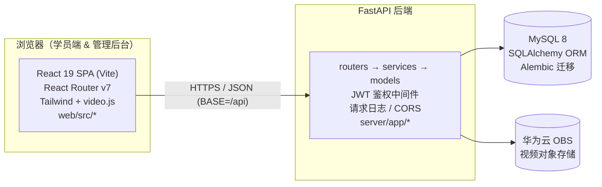

# Hi-Tronics 在线学习平台 · 代码架构导航图

> 路径基准（项目根）：`Hi-Tronics-Learning-platform/`
> 生成于 2026-09-04 · 用途：让 Claude / 开发者按功能一键定位源码文件
> **2026-09-20 更新**：见文末 §6「全量修复记录」，多处描述已与旧版不同。
> 所有下方路径均为相对项目根的路径。

## 技术栈

- **前端**：React 19 + Vite 8 + TypeScript + Tailwind CSS v4 + React Router v7 + video.js
- **后端**：FastAPI + uvicorn（Python），分层结构 `routers → services → models → schemas`
- **数据库**：MySQL 8，SQLAlchemy 2 ORM，Alembic 迁移
- **对象存储**：**阿里云 OSS**（视频，`oss2` SDK + 预签名 URL 直传/直连播放），本地回退 `server/uploads/`
  （旧文档写的「华为云 OBS」已过时，代码中 `config.py` / `routers/videos.py` 用的是阿里云 OSS）
- **认证**：JWT（HS256），有效期 24h，token 存 localStorage（`web/src/lib/api.ts` 注明 XSS 风险）；企业微信 OAuth 已接入；OA 免密 SSO 已接入
- **登录限流**：内存双维度（IP + 账号），仅信任可信代理透传的 `X-Forwarded-For`

---

## 1. 系统架构总览

**认证说明**：JWT 存于 localStorage（XSS 风险，见 `web/src/lib/api.ts` 注释）；有效期 24h；企业微信 OAuth 字段（`WECHAT_CORP_ID` 等）已在 `server/app/config.py` 预留。

---

## 2. 后端分层结构（`server/app/`）

| 文件 / 目录 | 作用 |
|---|---|
| `main.py` | 应用入口：注册 14 个 router、CORS、请求日志中间件；lifespan 中建表 + 种子内置管理员 |
| `config.py` | `Settings`：DB / JWT / OBS / 企业微信 配置，全部来自环境变量 |
| `database.py` | SQLAlchemy engine、`SessionLocal`、`Base` |
| `logger.py` | 结构化日志 `setup_logging` / `get_logger` |
| `routers/` | 路由模块（见 §3 功能映射） |
| `services/` | `auth_service.py`（登录/密码/JWT）、`seed.py`（内置管理员）、`department_scope.py`（部门归属与课程分配统一判定）、`log_service.py`、`notice_service.py`、`oa_client.py`、`wechat_service.py`、`department_sync.py` |
| `schemas/` | Pydantic 校验：auth / user / exam / course / question / paper / question_tag / department / knowledge_node / notice / task |
| `models/` | ORM 模型：user / department / course / exam / question / paper / question_tag / question_category / learning_progress / knowledge_node / notice / system_log / task |
| `tests/` | `test_auth.py`、`test_exam_flow.py`、`test_security_fixes.py`（安全回归） |
| `alembic/` | 数据库迁移（**现在是 schema 的唯一来源**，见 §6） |

**router 注册清单（在 `main.py`）**：auth, users, departments, courses, videos, questions, exams, student_exam, question_tags, question_categories, learning_progress（含 admin_router）, papers, knowledge, logs, notices, admin_dashboard, tasks（含 plan_router）, sso（含 api_router）

---

## 3. 功能 → 代码定位映射（核心）

> 每张表给出：前端路由 + 页面组件、后端 router + 关键端点、涉及模型/校验层。
> 路径均相对项目根。

### 3.1 登录 / 认证
- **路由**：`/login`
- **前端**：`web/src/pages/Login.tsx` · `web/src/hooks/useAuth.tsx` · `web/src/lib/api.ts`（`login` / `getMe`）
- **后端**：`server/app/routers/auth.py`
- **端点**：`POST /api/auth/login` · `GET /api/auth/me`
- **其它**：`server/app/services/auth_service.py` · `server/app/schemas/auth.py` · `server/app/models/user.py`

### 3.2 用户管理
- **路由**：`/admin/users`
- **前端**：`web/src/pages/admin/DepartmentUserManage.tsx`
- **后端**：`server/app/routers/users.py`
- **端点**：`GET/POST /api/users` · `PUT /api/users/{id}`（`/role`、`/status`）· `DELETE /api/users/{id}` · `POST /api/users/batch-import` · `GET /api/users/batch-import/template`
- **模型**：`server/app/models/user.py` · `server/app/schemas/user.py`

### 3.3 部门管理
- **路由**：`/admin/users`（与用户同页，含部门树）
- **前端**：`web/src/pages/admin/DepartmentUserManage.tsx`
- **后端**：`server/app/routers/departments.py`
- **端点**：`GET/POST /api/departments` · `PUT/DELETE /api/departments/{id}` · `GET /api/departments/flat` · `GET /api/departments/{id}/users`
- **模型**：`server/app/models/department.py` · `server/app/schemas/department.py`

### 3.4 课程管理（后台）
- **路由**：`/admin/courses`
- **前端**：`web/src/pages/admin/CourseManage.tsx`
- **后端**：`server/app/routers/courses.py`
- **端点**：CRUD `/api/courses` · `POST /api/courses/{id}/videos` · `PUT /api/courses/{id}/videos/reorder` · `DELETE /api/videos/{video_id}` · `POST /api/courses/{id}/assignments`
- **模型**：`server/app/models/course.py`（Course / Video / CourseAssignment）· `server/app/schemas/course.py`

### 3.5 课程学习（学员端）
- **路由**：`/student` · `/student/courses/:id`
- **前端**：`web/src/pages/student/Dashboard.tsx` · `web/src/pages/student/CourseDetail.tsx`
- **后端**：`server/app/routers/courses.py`
- **端点**：`GET /api/student/courses` · `GET /api/courses/{id}`
- **模型**：`server/app/models/course.py`

### 3.6 视频 / 课件播放
- **前端**：`web/src/components/VideoPlayer.tsx`（用于 CourseDetail）
- **后端**：`server/app/routers/videos.py`
- **端点**：`POST /api/videos/upload` · `GET /api/videos/play-url/{obs_key}` · `GET /api/videos/stream/{filename}`
- **存储**：`server/app/config.py`（`OBS_*` 配置）· 本地回退 `server/uploads/videos/`
- **模型**：`server/app/models/course.py`（Video）

### 3.7 知识管理 ⚠ 占位
- **路由**：`/admin/knowledge`
- **前端**：`web/src/pages/admin/KnowledgeManage.tsx`
- **后端**：⚠ 暂无独立后端模块，页面为占位（"知识库功能开发中…"）

### 3.8 题库 / 试题管理
- **路由**：`/admin/question-bank`
- **前端**：`web/src/pages/admin/QuestionBank.tsx` · `web/src/pages/admin/QuestionManage.tsx`（子组件）
- **后端**：`server/app/routers/questions.py` · `server/app/routers/question_tags.py` · `server/app/routers/question_categories.py`
- **端点**：CRUD `/api/questions`（+ `/batch`、`/export`、`/template`、`/import`、`/{id}/clone`）· `/api/question-tags`（tree/flat）· `/api/question-categories`（tree/flat/stats）
- **模型**：`server/app/models/question.py` · `server/app/models/question_tag.py` · `server/app/models/question_category.py` · `server/app/schemas/question.py`

### 3.9 试卷管理
- **路由**：`/admin/papers` · `/admin/exams/:id/paper`
- **前端**：`web/src/pages/admin/PaperManage.tsx` · `web/src/pages/admin/PaperCreate.tsx`（子组件）· `web/src/pages/admin/ExamPaper.tsx`
- **后端**：`server/app/routers/papers.py`
- **端点**：CRUD `/api/papers` · `GET /api/papers/published`
- **模型**：`server/app/models/paper.py` · `server/app/schemas/paper.py`

### 3.10 考试管理（后台）
- **路由**：`/admin/exams` · `/admin/exams/:id/results`
- **前端**：`web/src/pages/admin/ExamManage.tsx` · `web/src/pages/admin/ExamResults.tsx`
- **后端**：`server/app/routers/exams.py`
- **端点**：CRUD `/api/exams` · `GET/POST /api/exams/{id}/paper`
- **模型**：`server/app/models/exam.py`（Exam / ExamPaper / ExamResult）· `server/app/schemas/exam.py`

### 3.11 学员考试（答题）
- **路由**：`/student/exams/:id`
- **前端**：`web/src/pages/student/ExamPage.tsx`
- **后端**：`server/app/routers/student_exam.py` · `server/app/routers/exams.py`
- **端点**：`GET /api/student/exams/{id}/status` · `GET /api/student/exams/{id}/start` · `POST /api/student/exams/{id}/submit` · `GET /api/student/exams/{id}/results`
- **模型**：`server/app/models/exam.py` · `server/app/models/paper.py`

### 3.12 学习进度 / 档案
- **路由**：`/admin/users/progress` · `/student/profile`
- **前端**：`web/src/pages/admin/UserProgress.tsx` · `web/src/pages/student/Profile.tsx`
- **后端**：`server/app/routers/learning_progress.py`
- **端点**：`POST/GET /api/student/progress` · `GET /api/student/courses-with-progress` · `GET /api/student/profile` · `/api/admin`（后台进度）
- **模型**：`server/app/models/learning_progress.py`

### 3.13 系统日志
- **路由**：`/admin/logs`
- **前端**：`web/src/pages/admin/LogViewer.tsx`
- **后端**：`server/app/routers/logs.py`
- **端点**：`GET /api/admin/logs` · `GET /api/admin/logs/download`
- **日志**：`server/app/logger.py` · `server/app/main.py`（RequestLoggingMiddleware）

### 3.14 数据看板（首页）
- **路由**：`/admin` · `/student`
- **前端**：`web/src/pages/admin/Dashboard.tsx` · `web/src/pages/student/Dashboard.tsx`
- **后端**：聚合自 courses / users / learning_progress 等路由（无独立 dashboard router）

---

## 4. 前端骨架文件（入口 / 布局 / 公共）

| 文件 | 作用 |
|---|---|
| `web/src/main.tsx` | React 入口，挂载 App |
| `web/src/App.tsx` | 路由根：`/login` · `/student/*` · `/admin/*` |
| `web/src/lib/api.ts` | API 客户端（BASE=`/api`，自动附 JWT，401 跳登录） |
| `web/src/hooks/useAuth.tsx` | 认证 Context（user / login / logout） |
| `web/src/layouts/AdminLayout.tsx` | 后台布局 + 全部 `/admin/*` 子路由 |
| `web/src/layouts/StudentLayout.tsx` | 学员布局 + 全部 `/student/*` 子路由 |
| `web/src/components/ErrorBoundary.tsx` | 全局错误边界 |
| `web/src/components/VideoPlayer.tsx` | video.js 封装播放器 |
| `web/src/types/` | 前端 TypeScript 类型定义 |
| `web/vite.config.ts` | Vite 配置（devServer 端口 5178） |

---

## 5. 注意项 / 待办

- ✅ **知识管理已实现**（画布式知识地图 + 课件预览/文字提取），旧文档中「占位页、无独立后端」的说法已过时。
- **`QuestionManage.tsx` / `PaperCreate.tsx`** 不是孤儿文件，分别是 `QuestionBank` / `PaperManage` 的子组件。
- 🔒 **认证安全**：JWT 仍存 localStorage（`web/src/lib/api.ts` 注释已标记 XSS 隐患），
  建议后续改为 httpOnly Cookie + refresh token，并加 CSP。这是当前已知的**未修复**安全项。
- 无 `Role`/`Permission` 独立模型：当前角色判定依赖 `user.role`（admin/student），RBAC 权限体系尚未建模。
- 🗄 **数据库 schema 只由 alembic 管理**：`main.py` 启动时的 `create_all` 仅用于测试兜底，
  **不会 ALTER 已有表**。给模型加字段后必须写迁移，否则生产库不同步（历史上 SSO 的
  `workcode_hash` 就是这么坏掉的：ORM 没字段、库里也没列，接口必然 500）。

---

## 6. 全量修复记录（2026-09-20）

一次全量代码审查后集中修复，下列内容与旧版文档/代码行为不同，请以本段为准。

### 6.1 新增文件

| 文件 | 作用 |
|---|---|
| `server/app/services/department_scope.py` | 部门归属与课程分配的统一判定：**优先 `user.department_id` 外键**，包含祖先/后代部门；取代原先散落在 courses / learning_progress / tasks 中「取路径叶子名再按名字反查」的实现（同名叶子部门会算错人） |
| `server/alembic/versions/a7d3f5b92c14_*.py` | `exam_results.submitted_at` 改为可空、新增唯一约束与复合索引 |
| `server/tests/test_security_fixes.py` | 20 个安全/正确性回归用例，覆盖全部已修复缺陷 |
| `server/.env.example` | 环境变量模板（不含真实密钥） |

### 6.2 关键行为变化（可能影响既有集成）

1. **考试必须 `status="published"` 且在有开考时间窗内才能开始。** 草稿/已结束/未到开放时间/已过截止时间都会被拒绝（400）。
2. **学员必须被分配了课程才能参加该课程的考试**（原先任意学员可考任意考试）。
3. **刷新考试页面不再重置倒计时，也不再重新抽题**；剩余时间由服务端通过 `remaining_seconds` 下发。
4. **评分以「本次作答的题目快照」为唯一依据**：分母是快照全部题目的分值之和，未作答按 0 分计入；超出时长 + 60 秒宽限期交卷记 0 分并返回 `timed_out=true`。
5. **试卷每题配置的分值现在真正生效**（原先选择题硬编码 10 分）。
6. **删除考试/课程/视频需要 `confirm=true`**；若已有作答或学习记录，默认拒绝（409），需再传 `force=true` 才会连历史一起删除。
7. **删除视频/课程会同步清理 OSS 对象**。
8. **`GET /api/courses/{id}`、`/api/videos/play-url/{key}`、`/api/videos/stream/{file}` 都需要课程分配校验**（原先只校验登录）。
9. **`/api/questions/template` 需要管理员权限**。
10. **企微回调默认拒绝未校验的 `state`**（CSRF）；如需支持企微客户端直接打开，需显式设 `WECHAT_ALLOW_UNVERIFIED_STATE=true`。
11. **OA SSO 改用 `employee_id` / `username` 查用户**（不再依赖不存在的 `workcode_hash` 列），并新增票据防重放。
12. **前端 dev 代理目标改为 `VITE_PROXY_TARGET`**，默认 `http://localhost:8100`（原为 8002，被招聘系统占用导致前后端错配）。
13. **前端已做路由级代码分割**：登录页首屏 gzip 从 774KB 降到约 86KB。各页面为独立 chunk。
14. **前端仍不启用 `<StrictMode>`**（原因见 `web/src/main.tsx` 与 `web/src/components/VideoPlayer.tsx` 的注释）。

### 6.3 新增/变更配置项

| 变量 | 说明 |
|---|---|
| `SSO_SHARED_SECRET` | 配置后 OA 免密登录使用 HMAC-SHA256(secret, "工号:时间戳")，票据与工号绑定、无法伪造。**留空会回退到不安全的 md5(时间戳) 兼容模式并打 CRITICAL 日志，建议尽快配置并同步修改 OA 侧** |
| `WECHAT_ALLOW_UNVERIFIED_STATE` | 是否允许企微回调跳过 state 校验，默认 `false` |
| `TRUSTED_PROXY_IPS` | 可信反向代理 IP 列表；**默认空 = 忽略 `X-Forwarded-For`**，从而无法伪造 IP 绕过登录限流。部署在 nginx 后需填入 nginx 的 IP |
| `CORS_ORIGINS` | CORS 白名单，生产环境务必设置为实际域名 |
| `VITE_PROXY_TARGET` | 前端 dev 代理的后端地址 |

### 6.4 日志约定

`log_service.write_log()` **每次调用都会立即 commit**（保证审计日志不随业务事务回滚而丢失）。
这是有意设计，不要为了「少一次事务提交」去掉它。
